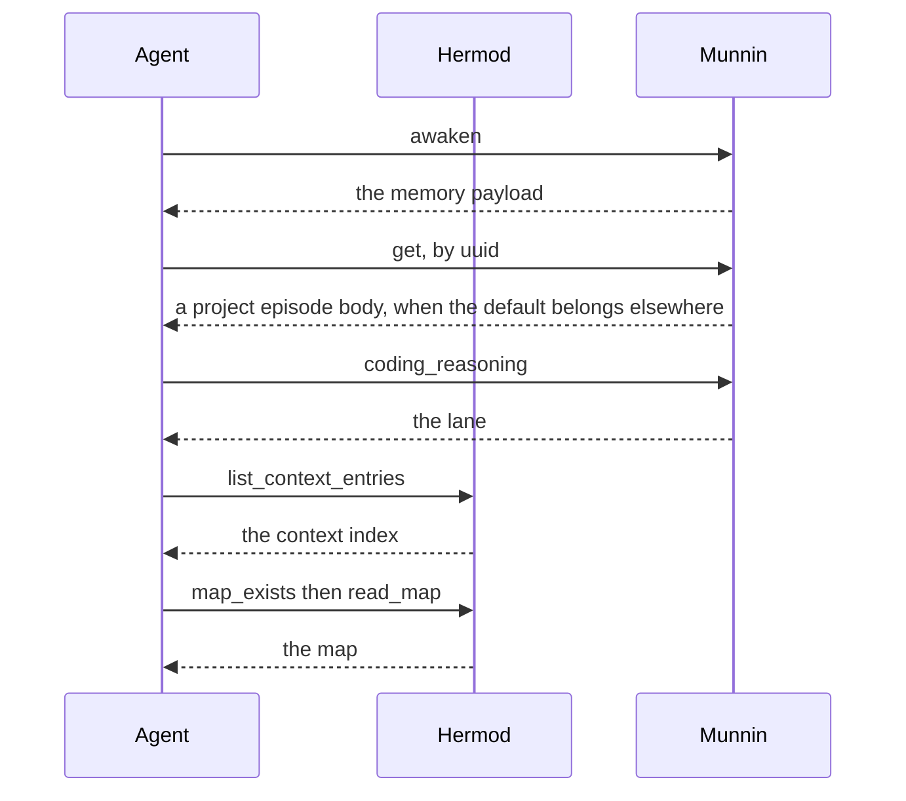
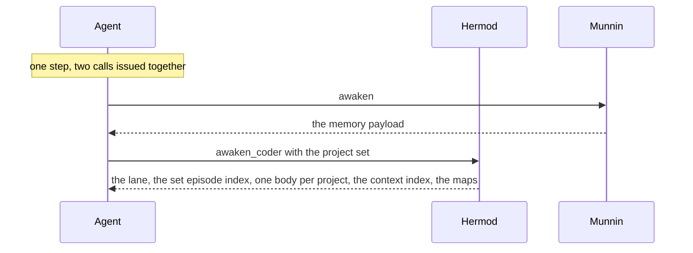

# High Wizard Plan

## **PROJECT INFO**
- **Project**: agent-memory-project (the coding overlay) · `hermod-server` carries the new tool
- **Date**: 2026-10-13
- **Agent**: meta
- **Theme**: One call for the coding awakening — an awakening payload on Hermod, so `/awaken-coder` asks Munnin once and Hermod once instead of five times
- **Source Protocol**: `/high-wizard` — /high-wizard

*CRITICAL INSTRUCTION: To continue this plan: load the source protocol above, then inspect which sections below are filled vs unfilled to infer your current step.*

---

## **INHERITED CONTEXT**
*Filled at investigation step 0 with whatever was settled before this plan existed. The two sources are recorded separately and never merged — write "None" under a part that does not apply.*
*These decisions are **not yours to reopen**. If one looks wrong, STOP and surface it to [USER-NAME] — do not silently re-decide it here or in Confirmed Decisions below.*

### From the Parent Plan
- **Parent plan**: None — not a sub-plan. This plan supersedes `agent-memory-server/plans/2026-10-13-agent-memory-server-awaken-time.md`, which scoped the composite onto Munnin and is archived as superseded.
- **Assigned scope**: Not handed down. Stated in the Scope section below.

| # | Inherited decision | Chosen | Parent's reason | Status |
|---|--------------------|--------|-----------------|--------|
| 1 | None | — | — | — |

- **Integration contracts**: None inherited.
- **Pushed-down open items**: None inherited.

### From Pre-Planning Discussion
- **Discussion**: Pre-planning discussion with Alvi, 2026-10-13 into 2026-10-14, in the session that removed the `project` parameter from Munnin's `awaken`
- **Agreed scope**: give a coding awakening one composite call on Hermod's face, so `/awaken-coder` asks Munnin once and Hermod once instead of five times.

| # | Settled decision | Chosen | His reason | Status |
|---|------------------|--------|------------|--------|
| 1 | The goal | Two calls, not five | *"let's cut hermod first into a single call. so /awaken-coder actually only do 2 requests: 1. awaken-agent tool 2. awaken-coder tool"* | Settled |
| 2 | Munnin's side | Untouched, stays project-blind | *"we already know the awaken-agent tools is fast"* | Settled |
| 3 | The join, where Hermod calls Munnin internally for one call | The next piece, not this one | *"I know that the best case is 1 call which hermod is calling munnin via API. but before that, ..."* | Settled |
| 4 | Trimming the awaken payload | Rejected | his core-only run in another project was fast with the same payload, which makes step count the lever and payload size not one | Settled |
| 5 | The tool's name | `awaken_coder` | *"just to be safe. let's name awaken_coder"*, following the framework's existing `create-agent` procedure / `create_agent` tool pair | Settled |
| 6 | The tool's shape | `awaken_coder(domain, projects)`, returning the lane, the set-scoped episode index, one episode body per project in the set, the context index for the set, and every map for the set | *"I'm thinking C ... if we provide the projects, that mean we also want the orientation map for the project"*, and on the episodic bodies, *"I'm thinking if we need to load each of the latest from the given projects"* then *"yes C"*: open items live in bodies while the index carries only titles, so a single body can leave the session's own repo out of its own carry-forward | Settled |

- **Considered and rejected**: a distinctive tool name (`coding_awakening`) and Hermod's bare `awaken`; keeping the four-call shape; a `parts` narrowing knob; deriving the resolved project from the first element of the set; and, earlier in the session, having Munnin's `awaken` return the complete set.
- **Left open**: nothing. Both scope edges, the ops this replaces and the fate of the superseded plan, were settled in the scope round.

---

## **OBJECTIVES**
Cut a coding awakening from five tool calls to two: one Munnin call for the memory set, one Hermod call for everything the overlay adds, issued together. Munnin is not touched. The overlay stops assembling an awakening out of four calls in its own procedure text.

### **Related Documents**
- [docs/flows/awaken-db.md](../../../../munnin-deploy/agent-memory-server/docs/flows/awaken-db.md) - the core tool's flow
- [docs/flows/awaken-agent.md](../../../../munnin-deploy/agent-memory-server/control-files/docs/flows/awaken-agent.md) - the core procedure's flow, markdown pathway
- [qa/checklists/awaken-project-blind.md](../../../../munnin-deploy/agent-memory-server/qa/checklists/awaken-project-blind.md) - the verification written for the change that preceded this one
- [procedures/awaken-coder.md](../procedures/awaken-coder.md) and [storage-backends/db.md](../storage-backends/db.md) - the procedure and the ops this plan rewrites
- [components/project-identity.md](../components/project-identity.md) - holds the rule about the set that this plan corrects
- `docs/adr/2026-10-12-hermod-doc-extraction-and-hermod-server.md` - records the deferred join, whose cost this plan reduces without paying it

### **SUCCESS CRITERIA**
- [ ] `/awaken-coder` completes with exactly two tool calls, `munnin.awaken` and `hermod.awaken_coder`, issued in one step
- [ ] The overlay's DB backend ops read from that payload; the markdown backend is untouched
- [ ] A test asserts Hermod's episode and lane reads apply the same hot-read filters Munnin applies
- [ ] The project-identity component no longer says the set widens the episodic recall only
- [ ] Unit tests green, and the payload verified live against a project with a map and one without
- [ ] Deployed through the overlay chain with one Hermod release, and the served procedure read back

---

## **SCOPE**

### In Scope
- The `awaken_coder` tool on `hermod-server`: a read-only composite returning the lane, the set-scoped episode index, the newest episode of every project in the set with its body, the context index for the set, and every map for the set
- Its repository reads for two Munnin-owned record types, with hot-read filter parity against Munnin asserted by test
- The overlay's `awaken-coder` body reworded, and its five DB backend ops replaced with payload reads
- `components/project-identity.md`: the line about what the set widens
- The deploy chain: overlay → `hermod-server` → `hermod-deploy`, then one Hermod release

### Out of Scope
- **Munnin, entirely.** No tool change, no record change, no deploy: its `awaken` is the fast half and stays as it is.
- **The join**, where Hermod calls Munnin internally for a single call. The ADR keeps that deferred, and this plan reduces the cost of not doing it rather than paying it.
- **The markdown backend's mechanics**, which stay file-based: there is no Hermod on that path.
- **Graphify or any other new map source.** The tool returns whatever a map record holds, so this can follow without changing the contract.
- **The harness cleanup** (the installed copies of the overlay procedure on this machine), which is its own piece already on the list.
- **The task-system hook**, which involves no store read.

---

## **CONFIRMED DECISIONS**
*Decisions made **by this plan** — asked-and-confirmed, and written-through with their reasons. Decisions settled before this plan existed are in [INHERITED CONTEXT](#inherited-context) above.*

| # | Decision | Chosen | Reason |
|---|----------|--------|--------|
| 1 | The tool's payload | The lane, the set-scoped episode index, **the newest episode of every project in the set, each with its body**, the context index for the set, every map for the set | One call has to carry the whole coding half of an awakening. One body per project removes the conditional `get(uuid)` *and* keeps every repo's open items in view: open items live in bodies while the index carries only titles, so a single body can leave the session's own repo out of its own carry-forward. Measured cost: 4,483 characters per body, about 3.4k tokens for a three-repo set against a payload of roughly 89k |
| 2 | The context index and the maps | Bodies stay out of the context index. Maps are whole, one per project in the set, each with its dates | An index is a pointer list, and bodies arrive on relevance. A map is loaded whole by the awakening today, and with the projects supplied the caller wants theirs, so the report can name each repo's map status |
| 3 | The tool's arguments | `awaken_coder(domain, projects)`, one argument for the set | The resolved project is already the set's first element by the project-identity rule, so a second argument would restate what the set means and could disagree with it |
| 4 | How Hermod gets Munnin's rows | Direct query for `episode` and `coding_reasoning` rows, plus a filter-parity test | The join is deferred by the inherited decisions and the rows are in the same database, so the reach stays narrow: two record types, read-only, not the awakening assembly |
| 5 | The replaced ops | On the DB backend, the five ops become payload reads rather than keeping their own calls | Two live paths for the same need would be worse than either, and the ops keep their names so the procedure body's shape survives |
| 6 | The rule about the set | `components/project-identity.md` is corrected: the set widens recall, context and maps | Decision 1 and 2 make the old line false. Caught before shipping rather than after, which is what the previous piece cost us |
| 7 | The tool's name | `awaken_coder` | Follows the framework's existing pair, the `create-agent` procedure and the `create_agent` tool, so it invents no convention. Prose keeps the separator honest: `/awaken-coder` for the procedure, `awaken_coder(...)` for the tool |
| 8 | The tool's shape and annotations | A composite, read-only, with a docstring stating it is the face's first assembled payload | Every other Hermod tool reads or writes a single record, so the exception carries its reason where the next reader will meet it |
| 9 | The two calls | Issued together, one step | They are independent, so the awakening pays one round trip of latency instead of two |
| 10 | The superseded plan | `2026-10-13-agent-memory-server-awaken-time.md` archived as superseded | It scoped the composite onto Munnin, and a resuming session finding it in `plans/` would build the wrong thing |
| 11 | The fleet pointer | Kept, evaluated from the payload: it fires only when the set's context index carries a roster entry, and silent otherwise | The migration already moved the roster read out of the overlay into `hermod-fleet`'s `load-fleet`, and the op as written names a tool nobody built. A hint is worth keeping; a read is not, and an unconditional line would fire in projects with no fleet |

---

## **SOLUTION**

### Architecture Overview
A coding awakening becomes two calls issued together. Munnin's `awaken(domain)` is unchanged and returns the 4-layer memory set plus the whole episode index. The new Hermod call returns the coding half of the same awakening: the reasoning lane, the episode index for the project set, one episode body per project, the context index for the set, and every map for the set. The overlay's procedure stops assembling anything, hands that payload to the agent, and reports.

### Component 1: `awaken_coder` on hermod-server
- **Purpose**: assemble the coding half of an awakening in one read-only call, so no client has to visit two servers four times to start a coding session.
- **Key Files**: `src/hermod/api_mcp/server.py` (register the tool), a new `src/hermod/business_services/awakening_service.py` (the assembly, composing repository reads rather than re-implementing Munnin's assembly), `src/hermod/data_repositories/project_repository.py` (the Protocol gains two reads), `src/hermod/data_repositories/record_project_repository.py` (their implementation), `tests/test_mcp_surface.py` plus new payload and filter-parity tests.

### Component 2: the overlay's procedure
- **Purpose**: consume that payload instead of assembling it, and report one carry-forward per repo.
- **Key Files**: `procedures/awaken-coder.md` (steps 2, 3, 4 and 6 reworded, and the report fold-in gains a per-repo section), `storage-backends/db.md` (the five ops become payload reads), `components/project-identity.md` (the line about what the set widens), with `storage-backends/markdown.md` deliberately untouched.

<!-- OPTIONAL SECTION A: Include when multi-system changes, multiple components interacting -->
### Integration Architecture

| Component | Integrates With | Data Flow | Dependencies |
|-----------|----------------|-----------|--------------|
| `awaken_coder` on Hermod | the shared store, and the overlay procedure as its only consumer | project set → one payload → the agent | two record types it does not own: `episode` and `coding_reasoning` |
| the overlay procedure | Hermod's tool, Munnin's `awaken`, the agent | two calls issued together → the payload → the report | both servers reachable in the same step |
| Munnin's `awaken` | nothing new | domain → the memory payload | unchanged by this plan |

**Blast radius, checked.** No stored data changes shape: the plan adds a payload and reads existing rows. One consumer must move in the same pass, the overlay's own text, because that text is what will name the new call: the procedure body and its DB backend. Two consumers lag by design: the markdown backend keeps its file-based mechanics, and the installed copies of the overlay command on this machine stay stale until the harness cleanup or a recompile, which is already its own piece. Deploy ordering follows: overlay → `hermod-server` → `hermod-deploy`, then the Hermod release, so the text that names the tool never lands before the tool exists.

<!-- OPTIONAL SECTION B: Include when changing data/process flow, API changes -->
### System Flow Diagrams

**Current State:**

**End Result:**

<!-- OPTIONAL SECTION C: Include when significant technical constraints exist -->
### Technical Considerations

- **Filter parity across two servers.** Hermod's new reads must apply the same hot-read filters Munnin applies, `deleted_date IS NULL` and `archived_date IS NULL`, or a deleted episode can surface as a carry-forward. Nothing enforces that agreement today, so a test asserts it by reading a soft-deleted episode through both servers and comparing.
  - The existing context reads already filter, so there is precedent in the same repository.
  - The test is the mechanism: a copied predicate with no check is exactly the shape that drifts.
- **A narrow reach into Munnin's rows.** The tool reads `episode` and `coding_reasoning` rows, both Munnin-owned, so the overlay's server gains a second reader of memory records. It does not re-implement the awakening assembly: it filters and returns one index, one body per project, the lane, the context index and the maps.
  - The join stays deferred; this reduces what not joining costs rather than paying it.
  - The ADR records the reach so the next boundary decision starts from it.
- **Payload growth.** One episode body measured 4,483 characters, so about 3.4k tokens for a three-repo set. Maps are whole and one per project, unmeasured at this size, and on a fully mapped set they are the largest addition.
  - If it ever bites, the lever is a narrowing argument on the call, which this plan deliberately does not add.
- **The Protocol change reaches test doubles.** `ProjectRepository` gains two reads, so every in-memory fake in the suite must implement them, and a fake that silently returns nothing would let a payload test pass while production returns nothing.
  - The payload test therefore asserts against content that exists, never an empty shape.
- **One argument, one convention.** The set's first element is the session's repo, which is what lets the resolved project stay implicit. The convention is documented in the tool's docstring, because a reordered set would silently change whose context and map come back.
- **The two backends diverge here, on purpose.** The markdown backend keeps file-based mechanics for the same ops, so one op name resolves differently per backend. That is the seam working as designed, and it stays documented in both files.

<!-- OPTIONAL SECTION F: Include for brainstorming/decision tasks, multiple viable approaches -->
### Solution Options & Evaluation

#### Solution Options
*List 5-8 potential solutions. Brief description for each.*

| # | Solution | Description |
|---|----------|-------------|
| 1 | Batch the existing calls | Keep the five tools, and have the procedure issue them in one step. |
| 2 | A narrowing knob on Munnin's `awaken` | Add `parts` or `include` so a coding client can ask for a subset of the memory set. |
| 3 | A composite on Hermod, two calls | Hermod assembles the coding half of the awakening; the client issues both calls together. |
| 4 | Hermod calls Munnin internally | One call for the client, with Hermod proxying the memory set. |
| 5 | Munnin returns the complete set | Munnin grows project-aware reads and the lane into its own payload. |
| 6 | Hermod re-implements the awakening | Hermod reads the memory rows and assembles everything itself. |

#### Evaluation
*Evaluate top candidates with pros/cons.*

| Solution | Pros | Cons |
|----------|------|------|
| Batch the calls | No new code, no deploy, nothing to keep in step | The five calls stay, and the batching lives in prose; the procedure still reads as five steps, which is what made a 14-step awakening in the first place |
| A composite on Hermod, two calls (chosen) | Two calls in one step; Munnin untouched; the overlay's five ops collapse into payload reads; the one-call future gets easier, because the composite's service is exactly where a Munnin client would be added | Hermod grows two reads of Munnin-owned rows and the filter-parity obligation that comes with them; the payload grows by one body per project and one map per mapped project |
| Hermod calls Munnin internally | One call for the client; the memory assembly stays in exactly one place | This is the join the ADR deferred: a credential, an availability dependency, and a hop inside every awakening, taken before it is needed |

#### Selected Approach
- **Chosen**: A composite on Hermod, two calls.
- **Rationale**: It removes three of five calls without crossing the join line the ADR deliberately left in place, it keeps Munnin the only thing that assembles memory, and it makes the one-call future smaller: the service this plan creates is where a Munnin client would later be added. Batching alone leaves the count intact, a knob on Munnin re-opens the project-shaped hole we just closed, and re-implementing the assembly buys speed with a second implementation that must be kept in step forever.

<!-- OPTIONAL SECTION G: Include when task produces an architecture decision record -->
### ADR Output
*When this section is confirmed, the procedure creates a separate ADR file using the [ADR Template]([path-to-agent-memory-wizards]/templates/adr-template.md).*

- **ADR File**: [2026-10-14-hermod-reads-memory-rows-for-the-coding-awakening.md](../docs/adr/2026-10-14-hermod-reads-memory-rows-for-the-coding-awakening.md) — ADR-029, created by Step 12
- **Decision Summary**: The coding awakening becomes one composite call on Hermod that reads two Munnin-owned record types directly, so a coding session starts in two calls instead of five, while the join between the servers stays deferred.

---

## **IMPLEMENTATION PHASES**

### Phase 1: The repository reads (hermod-server)
- [ ] **Step 1.1**: The two reads Hermod does not have yet
  - **Action**: Add `newest_episode_per_project(agent, projects)` and `coding_lane()` to `ProjectRepository`'s Protocol and to `RecordProjectRepository`, on both record tables.
  - **Implementation**: Follow the existing `_select` shape, and apply the same hot-read filters Munnin applies (`deleted_date IS NULL`, `archived_date IS NULL`). One query per need, no loop over projects in Python.
  - **Testing**: A parity test that soft-deletes an episode and archives another, then reads through Munnin and through Hermod and asserts the same set comes back.
  - **Success Criteria**: Both reads return only live rows, and deleting either filter from Hermod's query turns the parity test red.
- [ ] **Step 1.2**: The test doubles
  - **Action**: Implement the two reads in every in-memory fake the suite carries.
  - **Implementation**: A fake that returns `[]` must be impossible to mistake for a real empty store, so the payload test in Phase 2 asserts against content that exists.
  - **Testing**: Run the suite; a fake missing the new methods fails loudly rather than returning nothing.
  - **Success Criteria**: No test double silently satisfies the new interface with an empty result.

### Phase 2: The tool (hermod-server)
- [ ] **Step 2.1**: The assembly
  - **Action**: A new `business_services/awakening_service.py` that composes the four reads into one payload, and nothing more.
  - **Implementation**: It returns, in one dict: the lane, the episode index for the set, one newest episode body per project in the set, the context index for the set, and every map for the set with its dates. It does not resolve a project: the set's first element is the session's repo by convention, documented in the docstring.
  - **Testing**: A payload test against seeded records, asserting each part by content and asserting the resolved project is first.
  - **Success Criteria**: One call returns every part, and an empty set is impossible to confuse with an empty store.
- [ ] **Step 2.2**: Registration, annotations and the face's own test
  - **Action**: Register `awaken_coder` in `api_mcp/server.py`, read-only, with a docstring that says it is this face's first assembled payload and why the set's order matters.
  - **Implementation**: Put it beside the store tools rather than inside `_register_store`, so the one-tool-per-op rule stays legible where it applies.
  - **Testing**: `tests/test_mcp_surface.py` gains the tool name to its expected set, and the "share the face" assertion still holds.
  - **Success Criteria**: The tool is callable, read-only, and the surface test names it.

### Phase 3: The overlay's text (agent-memory-project)
- [ ] **Step 3.1**: The body
  - **Action**: Reword `procedures/awaken-coder.md` steps 2, 3, 4 and 6 so they read from the payload, and issue the two calls together.
  - **Implementation**: The report fold-in becomes one carry-forward per repo, the session's own first, and the fleet pointer fires only when the payload's context index carries a roster entry.
  - **Testing**: Compile the procedures, then read the served text back after the deploy in Phase 4.
  - **Success Criteria**: No step instructs a call the payload already answered.
- [ ] **Step 3.2**: The DB backend's ops
  - **Action**: `§ load-coding-reasoning`, `§ load-context-indexes`, `§ select-project-episode`, `§ map-exists`, `§ read-map` and `§ check-fleet-roster` become payload reads under the one call.
  - **Implementation**: The ops keep their names, so the body's shape survives; `storage-backends/markdown.md` is deliberately left alone. `§ check-fleet-roster` becomes a lookup in the set's context index: it fires when a roster entry is present and stays silent otherwise. The roster **read** belongs to `hermod-fleet`'s `load-fleet`, which already replaced it here, so no roster read is re-added.
  - **Testing**: The same read-back as Step 3.1.
  - **Success Criteria**: Each op names the one call and where its part of the payload comes from.
- [ ] **Step 3.3**: The rule about the set
  - **Action**: Correct `components/project-identity.md`: the set widens recall, the context index and the maps.
  - **Implementation**: One sentence, stating what decision 1 and 2 made true.
  - **Testing**: Read it back in the served text.
  - **Success Criteria**: The served procedure stops claiming the set widens the episodic recall only.

### Phase 4: Deploy, verify, measure
- [ ] **Step 4.1**: The chain and the release
  - **Action**: Push `agent-memory-project`, then the `hermod-server` gitlink, then the `hermod-deploy` gitlink, in that order; then one Hermod release against the `hermod-server` short SHA.
  - **Implementation**: The submodule first, every time: a gitlink that outruns its submodule fails the build at checkout.
  - **Testing**: Read `read_procedure("awaken-coder")` back and confirm the served text names `awaken_coder`.
  - **Success Criteria**: Served text and shipped code agree.
- [ ] **Step 4.2**: The live awakening
  - **Action**: Run a coding awakening in a repo with a map and in one without, and count what it costs.
  - **Implementation**: Two calls in one step; no `get`, no per-op call.
  - **Testing**: The reported carry-forward names each repo's open items, and the session's own repo comes first.
  - **Success Criteria**: The measured awakening is two calls, and the step count falls from the 14 measured on 2026-10-13 to roughly three.

---

## **EXECUTION LOG**
**Execution Protocol for AI**:
I have to use this document as my **ONLY** source of truth to execute and track the plan steps iteratively. I should **NOT** use additional tools like ToDos because it lacks the context of what should I do. Everytime I want to implement a step I have to check the reference to the original step plan above. Everytime a step has been finished I need to go back to this document to log what was done.
*In other words*:
- I have to make this document as the source of truth for the implementation phase on what I have worked on and what I will be working
- The original plan must be fully in my context, therefore, I have to make sure I loaded the **Plan File** before executing any task and read carefully the reference to the original step
- I have to do the implementation by doing it in order per step THEN, I ALWAYS have to fill the step log rightly after

**Definition of Done (applies to ALL steps)**:
- ✅ **Code Quality**: Code compiles/runs without errors
- ✅ **Testing**: Tests written and passing
- ✅ **Logged**: Implementation and testing logged below
- 🚫 **Blocked**: Get input from [USER-NAME] before assuming

### Phase 1:
- [ ] **Step 1.1**: [link to step above]
  - **Implementation Log**: [What was done]
  - **Testing Log**: [What was tested and results]
  - **Success Criteria**: [Pass/Fail against step's success criteria]
  - **Tech Debts**: [Optional - any shortcuts, TODOs, or future improvements noted]
  - **Result**: [Outcome compared to success criteria]

- [ ] **Step 1.2**: [link to step above]
  - **Implementation Log**: [What was done]
  - **Testing Log**: [What was tested and results]
  - **Success Criteria**: [Pass/Fail against step's success criteria]
  - **Tech Debts**: [Optional - any shortcuts, TODOs, or future improvements noted]
  - **Result**: [Outcome compared to success criteria]

### Phase 2:
- [ ] **Step 2.1**: [link to step above]
  - **Implementation Log**: [What was done]
  - **Testing Log**: [What was tested and results]
  - **Success Criteria**: [Pass/Fail against step's success criteria]
  - **Tech Debts**: [Optional - any shortcuts, TODOs, or future improvements noted]
  - **Result**: [Outcome compared to success criteria]

...{next phases as needed}...

---

## **QUALITY REVIEW**
*Filled by procedure Step 16 (delegated to `/analyze-code-quality` in embedded mode) after all execution phases are complete. **Static** review — answers "is the code clean?".*

- **Scope**: [Files reviewed — from Execution Log, reconciled against `git diff --name-only`]
- **Quality Standard**: [quality-standard.md found / not found — dimensions applied]
- **Findings**: [Issues found, or "No findings — implementation meets quality dimensions"]
- **Fixed**: [What was fixed from approved findings, or "N/A"]

---

## **QA HANDOFF**
*Filled by procedure Step 17 after Quality Review is resolved. This plan is **not** runtime-verified — this section records the plan for that verification, which happens in a QA session with the stack up.*

- **Scope**: the `awaken_coder` tool and its two repository reads on `hermod-server`, plus the overlay's procedure body and DB backend
- **QA instrument**: **NOT SET UP** — `hermod-server` carries no `qa/` directory at all, so there is no `qa/qa-map.md` and no bench. Step 17 will auto-skip for that reason.
- **Integration coverage**: **NONE** — the bench check failed (no instrument in this repository). Phases 1 to 3 cross real boundaries (two servers over MCP and HTTP, one shared database) and will carry unit tests only; Phase 4.2's live awakening is done by hand during implementation. Confirmed with Alvi, 2026-10-14, before implementation.
- **Checklist**: none — Step 17 auto-skips, no `qa/` folder is invented for a repository that never opted into the ontology.
- **Coverage split**: not applicable while the instrument is absent. The unit layer covers the two reads, the filter parity, the payload's shape and the surface registration.
- **Runtime verification**: **NOT DONE.** Next action: either set the instrument up for this repository first (`/map-qa-instrument create` then `/build-qa-bench`), or accept Phase 4.2's by-hand check as the only runtime evidence.

> Do not read a filled checklist as a passed one. This section says a verification *plan* exists, nothing more.

---

## **POST-COMPLETION**
After all phases are executed, logged, and both **Quality Review** + **QA Handoff** are filled, move this plan to `plans/completed/`:
`mkdir -p ./plans/completed && mv ./plans/[this-file].md ./plans/completed/[this-file].md`
