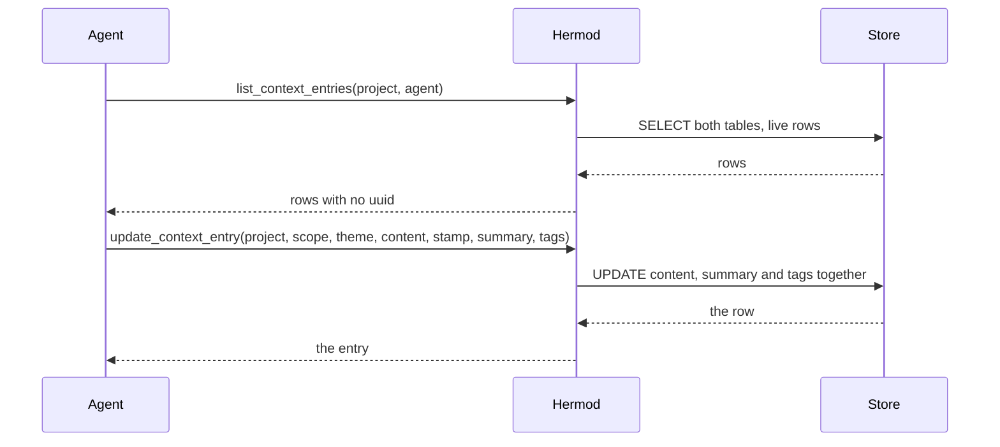
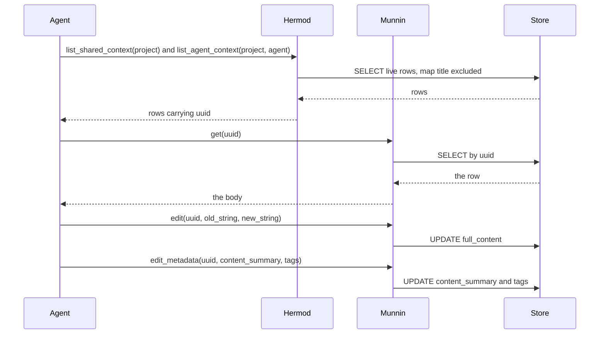

# High Wizard Plan

## **PROJECT INFO**
- **Project**: agent-memory-project (owns the overlay, `db.md` / `markdown.md`, the procedures and the family's ADRs; the code lands in `hermod-server`)
- **Date**: 2026-10-15
- **Agent**: meta
- **Theme**: Split Hermod's project-store surface into per-layer uuid-addressed ops (agent / shared), rename the layer vocabulary `private` → `agent`, and drop the file-era ops a store does not need
- **Source Protocol**: `/high-wizard` — chosen over `/quick-wizard` (the caller left the choice open: the work spans two repos plus a migration, and carries 10+ dependent substeps)

*CRITICAL INSTRUCTION: To continue this plan: load the source protocol above, then inspect which sections below are filled vs unfilled to infer your current step.*

---

## **INHERITED CONTEXT**
*Filled at investigation step 0 with whatever was settled before this plan existed. The two sources are recorded separately and never merged — write "None" under a part that does not apply.*
*These decisions are **not yours to reopen**. If one looks wrong, STOP and surface it to [USER-NAME] — do not silently re-decide it here or in Confirmed Decisions below.*

### From the Parent Plan
- **Parent plan**: None, this is not a sub-plan.
- **Assigned scope**: N/a.

| # | Inherited decision | Chosen | Parent's reason | Status |
|---|--------------------|--------|-----------------|--------|
| 1 | None | N/a | N/a | N/a |

- **Integration contracts**: None.
- **Pushed-down open items**: None.

### From Pre-Planning Discussion
- **Discussion**: Pre-planning discussion with Alvi, 2026-10-15. The whole design was settled in conversation in this session, before `/high-wizard` was chosen.
- **Agreed scope**: Rebuild the project store's tool surface as one primitive per (layer, action), addressed by uuid, with no `scope` argument anywhere in the interface; rename the layer vocabulary `private` to `agent`; drop the file-era ops; leave the deploy until the work lands.

| # | Settled decision | Chosen | His reason | Status |
|---|------------------|--------|------------|--------|
| 1 | Layer vocabulary | `shared` / `agent`, not `shared` / `private` | "the name is actually not private vs shared, it's actually agent context vs shared context" | Settled |
| 2 | Interface split | One primitive per (layer, action), no `scope` in any signature | "we can expose a separate interface, but the mechanism inside should be based on this, no entanglement allowed" | Settled |
| 3 | When merging is allowed | Only where the signature and the result are identical, which is `delete` only | "the only thing allowed to get is: delete project context, because it only pass uuid" | Settled |
| 4 | Merged create | Rejected | "it creates entanglement on 'agent' param (private required it, shared missing it)" | Settled |
| 5 | Addressing | The uuid is the address: the lists return it, read and delete take it | "uuid is exposed using the tool list, correct? so it doesn't make sense to address not using uuid?" | Settled |
| 6 | The op set | list / read / create / edit-metadata / delete per layer, plus the direction change, plus the merged delete | his own list, 2026-10-15 | Settled |
| 7 | `map_exists` | Dropped, and db's § map-exists resolves to `read_map` | "we have read_map, where found:false can also e true. map_exist simply not needed" | Settled |
| 8 | The map pair's names | `create_map` / `update_map` | "double create_map and write_map, one should write, one should edit. neither has edit / update name." | Settled |
| 9 | `check_entry_size` | Dropped, and db's § check-entry-size resolves to no action | "this should be just BE filter? not sure why we need this as a tool" | Settled |
| 10 | `content_summary` | Required, not optional | "content_summary should not be empty" | Settled |
| 11 | Deploy timing | One deploy after this work, at the latest pin | "we will deploy later to the latest after the edit_metadata is finished" | Settled |
| 12 | The body write's shape | Surgical, not a restate: `edit_context_entry(uuid, old_string, new_string, replace_all=false)` plus `multi_edit_context_entry(uuid, edits)`, mirroring Munnin's `edit` / `multi_edit` | "this needs to be surgical edit. so I think the terms update is not correct" | Settled, conditional on Hermod keeping a body edit at all |

- **Considered and rejected**: one surface with `scope` plus an optional `agent` (his reason: it entangles the owner argument, whose requiredness differs by layer) · deriving `content_summary` and `tags` from the document's own frontmatter (mine: a malformed frontmatter fails silently into a null summary, and a derived column fights the metadata op) · keeping `map_exists` and `check_entry_size` as read-only pre-flights (both are answered by an existing op) · addressing by the natural key with the uuid left unexposed (his reason: a returned handle should be the handle) · the wholesale `update_context_entry` as the body write (his reason: a body change should be a surgical edit, named as one).
- **Left open** (this plan's, from his "for starters"): whether the uuid is assigned or stays derived, and with it whether a scope change keeps the handle · how much of the uuid-addressed work Hermod keeps at all, given that Munnin's ops already act on these rows (its `get`, the `edit` family, `edit_metadata`, `soft_delete`) · whether `read` and `edit-metadata` merge or stay split · whether the direction change is two ops or one · `entry` / `entries` in the names.

---

## **OBJECTIVES**
Rebuild Hermod's project-store surface as one primitive per (layer, action), addressed by an assigned uuid, with the layer vocabulary renamed `private` to `agent`, the file-era ops removed, and every uuid-addressed read and write delegated to Munnin, so the project store is a view over the memory rows rather than a second writer of them.

### **Related Documents**
- [db.md](C:/Work/IM/hermod-deploy/hermod-server/agent-memory-project/storage-backends/db.md) - the DB backend's op definitions, which name the tools and must follow every rename
- [markdown.md](C:/Work/IM/hermod-deploy/hermod-server/agent-memory-project/storage-backends/markdown.md) - the markdown backend's twin semantics, and the vocabulary the two share
- [update-project-context.md](C:/Work/IM/hermod-deploy/hermod-server/agent-memory-project/procedures/update-project-context.md) - the capture flow, its scope confirmation and its create-versus-update branch
- [load-project-context.md](C:/Work/IM/hermod-deploy/hermod-server/agent-memory-project/procedures/load-project-context.md) - the load flow, which now costs one list call per layer
- [map-orientation.md](C:/Work/IM/hermod-deploy/hermod-server/agent-memory-project/procedures/map-orientation.md) - the map's flow, which loses `map-exists` and gains the renamed pair
- [ADR-027](C:/Work/IM/hermod-deploy/hermod-server/agent-memory-project/docs/adr/2026-10-13-hermod-store-is-valaskjalf-records.md) - the store is the memory database's records, which is what makes delegation possible
- [ADR-029](C:/Work/IM/hermod-deploy/hermod-server/agent-memory-project/docs/adr/2026-10-14-hermod-reads-memory-rows-for-the-coding-awakening.md) - the one payload that already reads these rows
- [postgres_memory_repository.py](C:/Work/IM/munnin-deploy/agent-memory-server/src/munnin/data_repositories/postgres_memory_repository.py) - `_locate` and the corpus predicate, the two mechanisms this plan leans on

### **SUCCESS CRITERIA**
- [ ] The store serves exactly the ops confirmed: two lists, two creates, two direction ops, three map ops, and the awakening, with no `scope` argument in any signature
- [ ] Every uuid-addressed read and write of a context entry resolves to a Munnin tool named by `db.md`, and Hermod no longer writes a body, a metadata field or a lifecycle flag
- [ ] The uuid is assigned at insert and returned by both lists, both creates, both direction ops and the awakening's `context_index`
- [ ] The layer vocabulary is `shared` / `agent` across the procedures, both backend docs, the entry template (stamp bumped), the payload values and the report prefixes
- [ ] The removed ops are gone from the surface, the seam and the procedures: `map_exists`, `check_entry_size`, and the store's own read, body write and delete, with the old direction change replaced by the two direction-specific ops
- [ ] Existing store tests pass after the split, and the served content recompiles with no drift
- [ ] The single deferred deploy puts it live, and the served face stops answering to `description`

---

## **SCOPE**

### In Scope
- **hermod-server, the store's code**: the repository and service split into per-layer primitives addressed by uuid; the uuid assigned at insert; the create reduced to a plain insert with no theme check and no revival of a retired row; the uuid in every payload; the map pair renamed with `map_exists` gone; `check_entry_size` gone with the cap kept as a creation gate; the awakening's `context_index` rows gaining `uuid`; the markdown importer calling the two creates; the test schema copy and every test that names the affected ops.
- **agent-memory-project, the served text**: `db.md`'s op definitions, four of which now name Munnin's tools and two of which resolve to no action; `markdown.md`, which shares the vocabulary; the four procedures that name these ops (`load-project-context`, `update-project-context`, `map-orientation`, `project-wrap-up`), where a theme name is only how the agent recognizes the row it means and every access is by uuid; the entry template, whose prose names the tools and therefore bumps its stamp; and this plan.
- **The vocabulary sweep**: `private` to `agent` wherever it names this layer, across the code, the tests, both backend docs, the procedures (including `awaken-coder`, which names the report prefixes), the payload's `scope` value and the awakening report's prefixes.
- **The integration**: `db.md` naming the memory layer's tools where the store's own ops used to be, and the assertions that pin those names.
- **The release**: the two pins and the single deferred deploy at the latest pin.

### Out of Scope
- **Any change in agent-memory-server.** Uniqueness is the uuid alone, so there is no index, no migration and no hardening of that repo's write paths; it leaves the plan untouched.
- **The markdown backend's storage layout.** Directories, file names and the index file are unchanged; only the vocabulary in its prose moves.
- **A theme rename.** No op exists for one, and a second row on one theme is an accepted outcome rather than a state to prevent.
- **Growth enforcement after creation.** The 1000-line cap is a creation gate, and nothing bounds a later edit.
- **Older installed command copies.** Served-versus-installed drift is the framework's existing concern, and the deploy is what brings the served face forward.

---

## **CONFIRMED DECISIONS**
*Decisions made **by this plan** — both **asked-and-confirmed** by [USER-NAME] AND **written-through** (Zone A and B decisions made by the agent, recorded with their reasoning). The reasons serve as the analysis record.*
*Decisions settled before this plan existed — by a parent, or in a pre-planning discussion — belong in [INHERITED CONTEXT](#inherited-context) above, not here. Keeping them separate is what shows which decisions this plan actually owns.*

| # | Decision | Chosen | Reason |
|---|----------|--------|--------|
| 1 | The uuid's source | Assigned (`uuid4`) at insert, and no uniqueness beyond the uuid | [USER-NAME]: "uniqueness only apply in uuid, nothing else". An assigned uuid keeps the handle stable across a direction change, so the theme becomes a name rather than a key. It also dropped the index half of the option as first presented, and with it the migration and the hardening in agent-memory-server. |
| 2 | How much of the store Hermod keeps | Discovery and creation only: two lists, two creates, two direction ops, three map ops and the awakening. Every uuid-addressed read and write is Munnin's | The delegated ops already act correctly on these rows (`_locate` probes both tables by uuid), and Munnin's browse and search exclude project-scoped knowledge rows by design, which makes a list the only door to a uuid. One implementation per rule beats two, which is the entanglement this work removes. |
| 3 | The 1000-line cap | A creation gate: the creates refuse a document over the limit | The markdown twin keeps the same threshold, and once the body writes belong to Munnin nothing after creation can enforce it, so the rule is stated as what it is instead of pretending to hold later. |
| 4 | The direction change | Two ops: `promote_context_entry(uuid)` into shared, `demote_context_entry(uuid, agent)` into the agent layer | The signatures genuinely differ, because the target of a demote needs an owner for `agent_id`. [USER-NAME]'s merge rule allows a single op only where the signature and the result are identical. |
| 5 | The names | `entry` dropped from the two lists, kept on the item ops | A list takes the layer as its object, while an item op takes one row, and the noun is what marks the one row in that table which is not an entry, the orientation map. |
| 6 | The uuid in payloads | Returned by both lists, both creates, both direction ops and the awakening's `context_index` | The uuid is the address, so a row a caller cannot name is a row it cannot read or retire. |
| 7 | A uuid held by both tables | Raise, naming the collision | `uuid` is unique within each table and not across the two, so silently picking one would serve the wrong row. |
| 8 | The map | `read_map(project)`, `create_map`, `update_map`, an assigned uuid, and its row excluded from every entry op | A project has exactly one map, which makes the project a complete address; the reserved title is already filtered out of the lists and must be filtered out of the uuid probes as well. |
| 9 | What "live" means | The context reads exclude archived rows as well as tombstoned ones, and the lists take no flag | [USER-NAME]: default reads exclude archived, and the opt-in door is the generic browse. Delegation is what made archiving reachable, so the lens retires a row when the store does. |
| 10 | A create over an existing theme | No check at all: the create assigns a uuid and inserts a new row, whatever state any existing row is in | [USER-NAME]: "archived or not, doesn't really matter. create new row." A duplicate theme is an accepted outcome, so the store neither refuses one nor revives a retired row, and the guard the create used to carry moves into the flow: Step 4 compares the themes by name only to decide create versus update, and every read or write after that is addressed by the uuid the list returned. |

---

## **SOLUTION**

### Architecture Overview

The store stops being a writer and becomes a lens. Ten ops stay on Hermod, in three groups: discovery (the two lists), creation (the two creates, each behind the entry's gates), and the map (read, create, update), with the awakening as a read over both. Every uuid-addressed read or write of a context entry is the memory layer's, named by `db.md`'s op definitions rather than implemented here. The identity is the uuid, assigned at insert. The theme is a display name with no key behind it, and `live` means one thing everywhere: both lifecycle flags null.

### Component 1: The store repository
- **Purpose**: the per-layer primitives over the two record tables, with the assigned uuid, the live-only filters and the reserved map title excluded from every entry probe.
- **Key Files**: `src/hermod/data_repositories/record_project_repository.py`, `src/hermod/data_repositories/project_repository.py` (the protocol it implements).

### Component 2: The service layer and its gates
- **Purpose**: the per-layer methods, the size cap and the template stamp both applied at creation only, the two direction ops, and the map's three ops.
- **Key Files**: `src/hermod/business_services/context_service.py`, `src/hermod/business_services/awakening_service.py`.

### Component 3: The MCP face
- **Purpose**: the ten tools with their docstrings, the uuid in the entry payload, and the dropped tools gone from the surface.
- **Key Files**: `src/hermod/api_mcp/server.py`.

### Component 4: The seam's DB definition
- **Purpose**: the `§` ops, four of which now name the memory layer's tools, plus the two that resolve to no action.
- **Key Files**: `agent-memory-project/storage-backends/db.md`.

### Component 5: The procedures and the templates
- **Purpose**: the flow's wording, where a theme name is only how the agent recognizes the row it means, the shared vocabulary, and the entry template whose prose names the tools and therefore bumps its stamp.
- **Key Files**: `procedures/load-project-context.md`, `procedures/update-project-context.md`, `procedures/map-orientation.md`, `procedures/project-wrap-up.md`, `templates/project-context-template.md`, `storage-backends/markdown.md`.

### Component 6: The contract copy and the tests
- **Purpose**: the schema copy stays index-free, and the store, surface, importer and end-to-end tests follow the split.
- **Key Files**: `tests/valaskjalf_schema.py`, `tests/test_record_repository.py`, `tests/test_mcp_surface.py`, `tests/test_markdown_importer.py`, `tests/test_end_to_end.py`.

<!-- OPTIONAL SECTION A: Include when multi-system changes, multiple components interacting -->
### Integration Architecture

| Component | Integrates With | Data Flow | Dependencies |
|-----------|----------------|-----------|--------------|
| The two lists | `shared_record` / `memory_record`, the awakening | SELECT live rows, the reserved map title excluded | the tenant the token resolves to |
| The two creates | `shared_record` / `memory_record` | a document plus a stamp → INSERT with a fresh uuid | the served entry template's stamp |
| The map's three ops | `shared_record` | the map document → the one row titled `orientation-map` | the orientation-map template's stamp |
| The agent's read | Munnin's `get` | a uuid → the record, `agent_id` present only in the agent layer | the uuid a list returned |
| The agent's body edit | Munnin's `edit` / `multi_edit` / `append` / `prepend` | a uuid plus old and new text → UPDATE of `full_content` | the corpus, no stamp |
| The agent's metadata edit | Munnin's `edit_metadata` | a uuid plus fields → UPDATE of `content_summary` / `tags` | the corpus, no stamp |
| The agent's delete | Munnin's `soft_delete` | a uuid → `deleted_date` set, first timestamp kept | the corpus |
| The seam | the procedures | a `§` op name → the tool call it defines | the overlay checkout baked into the image |

<!-- OPTIONAL SECTION A2: Include when a change alters a data shape/format/contract that CROSSES a system, service, or process boundary (a field's type/nullability, a string format, an enum value, a serialized payload, a DB column another app reads). Skip for single-system internal changes. -->
### Cross-System Contract Impact (Blast-Radius Check)

*A producer-side change to shared data silently breaks consumers that nobody updated in the same pass. Enumerate EVERY consumer of the changed shape and how each is verified BEFORE shipping. Producer and consumers are usually separate deploys.*

**Change classification** (check all that apply): ☑ field type/nullability ☐ string/ID format ☑ enum value added/changed ☑ new/removed field ☑ semantics changed (same shape, new meaning)

| # | Consumer (system + path) | How it couples (deserialize / string-parse / DB-read / migrate / display) | Breaks how on this change? | Verified / mitigated |
|---|---|---|---|---|
| 1 | The coding agent, reading `awaken_coder` | deserialize | none: `uuid` is additive, and the renamed `scope` value is a label | a payload test pins the row shape and the uuid's presence |
| 2 | The served procedures and both backend docs | read as instructions, naming `§` ops | silent-wrong: a stale doc names a tool that no longer exists | code and served text ride one image, and the served-content tests pin the pair |
| 3 | A client's cached tool list | the list is read at connect | a call to a removed tool fails, loudly | the client reconnects after the deploy and re-reads the list |
| 4 | A markdown-backend client | its own procedures and docs | none: only prose vocabulary moves | the same repo, swept in one pass |
| 5 | Munnin's own ops over these rows | DB-read of the same tables | none: it addresses by uuid before and after | its code is untouched, and the tables keep their shape |
| 6 | The markdown importer | it calls the creates by name | a name mismatch at call time | updated in the same pass, pinned by its tests |

- **Deploy ordering**: the two pins, then the single deploy (`agent-memory-project` into `hermod-server`, then into `hermod-deploy`). The code and the served text ride one image, so nothing inside Hermod skews; the live face keeps answering to `description` and keeps serving the old ops until that deploy runs.
- **Existing data**: rows keep the uuids they already carry, because a derived value is still just a string, so nothing is migrated and no reader meets two formats. The natural identity was never a constraint, and this change adds none.
- **Project registry**: none exists for this family.

<!-- OPTIONAL SECTION B: Include when changing data/process flow, API changes -->
### System Flow Diagrams

**Current State:**

**End Result:**

<!-- OPTIONAL SECTION C: Include when significant technical constraints exist -->
### Technical Considerations

- **Both gates now live at creation only.** The 1000-line cap and the template stamp are enforced by the creates, and the memory layer's `edit` family knows neither, so an entry can be grown or restated without a stamp. The precondition of a surgical edit (a matching `old_string`) is what keeps the stamp's purpose partly intact, and `db.md` states the rest where the creates are defined.
- **`live` has one meaning.** `deleted_date IS NULL AND archived_date IS NULL`, applied by both lists and by the awakening's index read, which is what makes archive mean the same thing in the lens and in the store.
- **The uuid becomes visible for the first time.** Until now no caller could name one of these rows, which is exactly why only Hermod could write them. Handing uuids out is what makes the delegation real, and it is also what makes archiving reachable.
- **The theme is not a key.** Two rows may carry one theme, the create does not check, and the flow's Step 4 comparison is the guard. Nothing outside the flow depends on a theme being unique.
- **The reserved map title has no constraint of its own.** The lists exclude `orientation-map` by title, and every entry probe must exclude it too, or a map row could be served as an entry and `map_exists` could be satisfied by something that is not a map.
- **The served face lags until the deploy.** Until then the live Hermod still answers to `description`, still serves the old ops, and returns no uuid, so nothing in this work is verifiable against production before that deploy runs.

<!-- OPTIONAL SECTION F: Include for brainstorming/decision tasks, multiple viable approaches -->
### Solution Options & Evaluation

#### Solution Options

| # | Solution | Description |
|---|----------|-------------|
| 1 | The natural key stays the address | Keep `(project, scope, theme, agent)` as the handle and never expose a uuid |
| 2 | The uuid is derived and exposed | Keep `uuid5` over the identity, return it, and let a direction change re-address the row |
| 3 | The uuid is assigned, with a natural-key index | Assign `uuid4` and add a partial unique index on the identity in agent-memory-server |
| 4 | One surface with a `scope` argument | Keep one set of ops and pass the layer in, with `agent` optional |
| 5 | The lens is self-contained | Hermod implements its own read, body edit, metadata edit and delete |
| 6 | The lens delegates the uuid-addressed ops | Hermod keeps discovery and creation; everything addressed by uuid is the memory layer's |
| 7 | A create revives a retired row of the same theme | Find that row and clear its retirement before inserting |

#### Evaluation

| Solution | Pros | Cons |
|----------|------|------|
| The natural key | no uuid exposure, and the address is readable | the caller carries four arguments, and the agent argument cannot be derived |
| The derived uuid | no migration, and the handle is a function of the identity | the handle dies on a direction change, and with uniqueness on the uuid alone a rename leaves it stale |
| Assigned uuid plus an index | a stable handle, and the identity becomes a constraint | a migration in a third repo plus the hardening of its write paths, for a duplicate [USER-NAME] does not consider a problem |
| One surface with `scope` | fewer tools | an `agent` argument required by one value of `scope` and meaningless for the other |
| A self-contained lens | works with Hermod alone, and every payload is entry-shaped | three writes implemented twice, and one metadata field with two rule-sets |
| Delegation | one implementation per rule, and the delegated ops already work on these rows | the client needs both servers connected, and the cap and the stamp gate creation only |
| Revival on create | a theme stays on one row with one history | [USER-NAME] ruled it out, retired rows are left alone |

#### Selected Approach
- **Chosen**: 6 for the surface, 3 as [USER-NAME] narrowed it (the assigned uuid, no index), and 4's rule applied in reverse: a layer is never a parameter inside Hermod, so nothing merges across layers.
- **Rationale**: the uuid is the only thing that makes one of these rows nameable, and naming it is what lets the memory layer's already-correct uuid ops do the writing. That removes the duplicated implementation which caused the entanglement in the first place: one body write, one metadata write, one tombstone. The index was dropped when uniqueness was set to the uuid alone, which also took the third repository out of the work.

<!-- OPTIONAL SECTION G: Include when task produces an architecture decision record -->
### ADR Output
*When this section is confirmed, the procedure creates a separate ADR file using the [ADR Template]([path-to-agent-memory-wizards]/templates/adr-template.md).*

- **ADR File**: `docs/adr/2026-10-15-hermod-store-is-a-uuid-addressed-lens.md`
- **Decision Summary**: the project store is a lens over the memory rows, addressed by an assigned uuid, with every uuid-addressed read and write delegated to the memory layer.

---

## **IMPLEMENTATION PHASES**

### Phase 1: The store's code, unit-tested
- [x] **Step 1.1**: The per-layer repository and its protocol
  - **Action**: Replace the theme-addressed methods with per-layer primitives addressed by uuid, and update the protocol to match.
  - **Implementation**: in `record_project_repository.py`, delete `entry_uuid` and the derived identity, and drop `get_context_entry`, `update_context_entry`, `move_context_entry`, `delete_context_entry` and `map_exists`. Add the two lists, the two creates assigning `uuid4`, the two direction ops, and the map trio. Every entry probe filters to live rows (`deleted_date IS NULL AND archived_date IS NULL`) and excludes `title = 'orientation-map'`; a uuid found in both tables raises.
  - **Testing**: `tests/test_record_repository.py` rebuilt around the new surface: a create returns its uuid; a second create on one theme adds a second row and raises nothing; a list hides a tombstoned row, an archived row and the map row; a promote and a demote keep the uuid; a uuid present in both tables raises.
  - **Success Criteria**: the repository serves only the confirmed ops, and its tests pass against the schema copy.

- [x] **Step 1.2**: The service layer and its gates
  - **Action**: keep the cap and the stamp, now at creation only, and expose the map ops.
  - **Implementation**: in `context_service.py`, delete `update_context_entry` and `check_entry_size`; keep `_refuse_oversized` and `_refuse_stale_template` on both creates; add the map methods.
  - **Testing**: units for a refused oversized create, a refused stale stamp, an accepted create, and a create over a theme that already has rows.
  - **Success Criteria**: no service method writes a body, a metadata field or a lifecycle flag.

- [x] **Step 1.3**: The MCP face
  - **Action**: register ten tools and remove the rest.
  - **Implementation**: in `server.py`, the two lists, the two creates, the two direction ops and the three map ops; the entry payload carries `uuid`; the dropped tools and their docstrings go.
  - **Testing**: `tests/test_mcp_surface.py` asserts the tool set by name and the payload keys.
  - **Success Criteria**: exactly nine store ops are served beside the awakening.

- [x] **Step 1.4**: The awakening, the importer and the contract copy
  - **Action**: the uuid reaches the index rows, the importer calls the two creates, and the schema copy stays index-free.
  - **Implementation**: `_context_row` in `awakening_service.py` gains `uuid`; `markdown_importer.py` chooses the create from the source path's scope; `tests/valaskjalf_schema.py` states why no index is added.
  - **Testing**: `test_markdown_importer.py`, `test_end_to_end.py` and the payload test green, the last asserting the uuid.
  - **Success Criteria**: an import produces rows the lists return with their uuids, and the suite passes, with CI running the 49 database tests the local run skips.

### Phase 2: The seam and the served text
- [x] **Step 2.1**: `db.md`
  - **Action**: rewrite the op definitions around the new surface.
  - **Implementation**: the four ops naming the memory layer's tools (`get`, `edit`, `edit_metadata`, `soft_delete`), the two resolving to no action (`§ map-exists`, `§ check-entry-size`), the renamed map pair, the vocabulary, and the note that the cap and the stamp are creation gates.
  - **Testing**: hermod-server's `test_loader.py` and `test_fidelity.py`.
  - **Success Criteria**: every `§` op a procedure names resolves to a tool or to no action, and no definition names a dropped tool.

- [x] **Step 2.2**: The vocabulary sweep
  - **Action**: `private` becomes `agent` wherever it names this layer.
  - **Implementation**: `markdown.md`, the five procedures (`load-project-context`, `update-project-context`, `map-orientation`, `project-wrap-up`, `awaken-coder`), the payload value and the report prefixes. The map's own `role-private` stays, since it is a different concept.
  - **Testing**: a grep for the layer sense of `private` across the overlay, plus the overlay's own tests.
  - **Success Criteria**: one vocabulary for the layer across the seam and the procedures.

- [x] **Step 2.3**: The flow wording
  - **Action**: Step 4 of `update-project-context` says the theme only decides create versus update, and that every access is by uuid; `load-project-context` costs one list per layer.
  - **Implementation**: the two procedures' steps and their op references.
  - **Testing**: a read-through of both procedures against `db.md`.
  - **Success Criteria**: neither procedure implies a theme-addressed read or write.

- [x] **Step 2.4**: The entry template and its stamp
  - **Action**: the template's prose names the new tools, so its stamp bumps.
  - **Implementation**: `templates/project-context-template.md`, then `setup-scripts/compile-procedures.py --strict` and the served-content tests.
  - **Testing**: a strict compile with no unresolved reference, plus `test_fidelity.py`.
  - **Success Criteria**: the served text and the checkout agree, and the stamp a writer declares is the new one.

### Phase 3: The release
- [x] **Step 3.1**: Pin the overlay into `hermod-server`
  - **Action**: bump the submodule pin, commit, push, and wait for the image.
  - **Implementation**: `git add agent-memory-project`, commit, push, then wait for `build-image.yml` to publish the tag for that commit.
  - **Testing**: the build run's conclusion, read from the runs.
  - **Success Criteria**: an image exists for the new overlay pin.

- [x] **Step 3.2**: Pin and deploy
  - **Action**: bump the pin in `hermod-deploy` and dispatch the deploy.
  - **Implementation**: `git add hermod-server`, commit, push, then `gh workflow run deploy.yml -R alvseek/hermod-deploy -f version=<short sha> -f command=deploy`.
  - **Testing**: the deploy run's conclusion.
  - **Success Criteria**: the box runs the new image.

- [x] **Step 3.3**: Verify from outside
  - **Action**: confirm the live surface from a client, not from the code.
  - **Implementation**: read the live tool list for `list_shared_context` and `create_agent_context_entry` and the absence of `read_context_entry`; call a list and check that a row carries `uuid`; call the memory layer's `get(uuid)` on it for the body.
  - **Testing**: those three calls, by hand, against the connected servers.
  - **Success Criteria**: the served face answers to the new names, returns uuids, and its rows are readable through the memory layer.

---

## **EXECUTION LOG**
**Execution Protocol for AI**:
I have to use this document as my **ONLY** source of truth to execute and track the plan steps iteratively. I should **NOT** use additional tools like ToDos because it lacks the context of what should I do. Everytime I want to implement a step I have to check the reference to the original step plan above. Everytime a step has been finished I need to go back to this document to log what was done.
*In other words*:
- I have to make this document as the source of truth for the implementation phase on what I have worked on and what I will be working
- The original plan must be fully in my context, therefore, I have to make sure I loaded the **Plan File** before executing any task and read carefully the reference to the original step
- I have to do the implementation by doing it in order per step THEN, I ALWAYS have to fill the step log rightly after

**Definition of Done (applies to ALL steps)**:
- ✅ **Code Quality**: Code compiles/runs without errors
- ✅ **Testing**: Tests written and passing
- ✅ **Logged**: Implementation and testing logged below
- 🚫 **Blocked**: Get input from [USER-NAME] before assuming

### Phase 1:
- [x] **Step 1.1**: The per-layer repository and its protocol
  - **Implementation Log**: Rewrote the context half of `record_project_repository.py`: deleted `entry_uuid`, `map_uuid` and `_UUID_NS` with the derived identity; added `list_shared_context`, `list_agent_context`, `create_shared_context_entry`, `create_agent_context_entry`, `promote_context_entry(uuid)` and `demote_context_entry(uuid, agent)`; renamed the map trio to `get_map` / `create_map` / `update_map` and removed `map_exists`; removed `get_context_entry`, `update_context_entry`, `move_context_entry` and `delete_context_entry`. The creates assign `uuid4` and make no theme check; the lists filter both lifecycle flags and exclude the reserved map title; `_locate_entry` probes both tables and raises when both hold the uuid (decision 7); `_row_to_entry` now takes the layer from its caller, since the table it was read from already knows it. `ContextEntry` gained `uuid`, `ContextScope.private` became `ContextScope.agent`, and the protocol was rewritten to match.
  - **Testing Log**: `py_compile` clean on the three files. `ruff check` clean after dropping the now-unused `ContextScope` import from the protocol. `pytest tests/test_record_repository.py` collects and reports 27 skipped: every test in that file is `postgres`-marked and `HERMOD_PG_TEST_URL` is unset locally, with no local database (docker is not running). The rewritten contract tests therefore execute in CI, which sets the URL from a service container.
  - **Success Criteria**: Partial by construction. The repository serves only the confirmed ops, and the contract tests are rewritten around them (create returns its uuid, a duplicate theme is allowed, both lists hide retired rows and the map, the direction ops keep the uuid, a uuid in both layers raises). Pass/fail on the database is CI's, not local.
  - **Tech Debts**: The `postgres`-marked suite cannot run locally without `HERMOD_PG_TEST_URL`, so a local session verifies syntax, lint and collection only. Pre-existing, and the same reason CI runs them.
  - **Kept deliberately**: the direction change still refuses a target layer that already holds the theme. The plan is silent on that rule, and the move sub-flow names it as its stop, so it was left as it was rather than assumed away; flipping it is one line plus one test.
  - **Result**: Met on the code and the tests; local execution of the database tests is not possible here.

- [x] **Step 1.2**: The service layer and its gates
  - **Implementation Log**: Rewrote `context_service.py` around the new surface: the two lists, the two creates behind one shared `_create_entry` gate path, the two direction ops, and the map trio `read_map` / `create_map` / `update_map`. Removed `read_context_entry`, `update_context_entry`, `move_context_entry`, `delete_context_entry`, `map_exists`, `check_entry_size` and the `SizeVerdict` dataclass that served the dropped measurement. The cap and the stamp now gate creation only, and `_refuse_blank_summary` was added, because an inherited decision requires the one-line summary and the memory layer's own insert refuses a blank one. The map's `content_summary` stays optional: that decision named the entry create, so extending it would be mine to make rather than the plan's.
  - **Testing Log**: `py_compile` and `ruff check` clean on the module and the test file; 28 tests collect. The gate tests were rewritten to the new signatures, one was added for the blank-summary refusal, and the line-cap test now asserts the refusal's own message, since no measurement is served back. The database tests skip locally as before.
  - **Success Criteria**: Met. No service method writes a body, a metadata field or a lifecycle flag: every method either reads rows or inserts a whole document once.
  - **Tech Debts**: None new.
  - **Result**: Complete, with the database-backed tests still CI's to run.

- [x] **Step 1.3**: The MCP face
  - **Implementation Log**: Rewrote `_register_store` in `server.py` to serve the nine ops: the two lists, the two creates (with `content_summary` now required rather than defaulting), the two direction ops, and the map trio. Removed `list_context_entries`, `read_context_entry`, `create_context_entry`, `update_context_entry`, `move_context_entry`, `delete_context_entry`, `check_entry_size`, `map_exists` and `write_map`, along with the `_scope_arg` helper and the now-unused `ContextScope` import. The entry payload gained `uuid` and no longer carries a body, because no remaining op returns one.
  - **Testing Log**: `py_compile` and `ruff check` clean across `src` and `tests`; 120 tests collect. The face tests were updated: `STORE_TOOLS` names the nine, and a new `DROPPED_TOOLS` set is asserted absent, so a tool that lingers without a document fails the suite. The end-to-end round trip now proves what Hermod alone can: the create returns the uuid, the listing returns that same row, and the other layer is empty. Full suite: 68 passed, 49 skipped, 3 failed, and all three failures are the importer still naming `ContextScope.private`, which is Step 1.4's work.
  - **Success Criteria**: Met. Exactly nine store ops are served beside the awakening, and the dropped names are gone from the face.
  - **Tech Debts**: None new.
  - **Result**: Complete, with the three remaining failures scoped to Step 1.4.

- [x] **Step 1.4**: The awakening, the importer and the contract copy
  - **Implementation Log**: `_context_row` in `awakening_service.py` gained `uuid`, and the service now assembles the context index with one list per layer (shared first, then the agent's), since the scope argument is gone. `markdown_importer.py` follows: the discovery scope is `ContextScope.agent`, the write goes through a two-branch `_create_entry`, and `_entry_present` was replaced by `_present_themes`, which reads each layer's listing once and tests membership. That replacement is forced rather than incidental: the importer's idempotence used to lean on the store's own theme lookup and its derived identity, and with both gone the check is the importer's job, as the store now allows two rows on one theme. The map's presence check uses `get_map`, since `map_exists` is gone. `tests/valaskjalf_schema.py` states, in prose, why no unique index on the natural identity is added.
  - **Testing Log**: `ruff check src tests` clean, and the full suite runs **71 passed, 49 skipped, 0 failed**, up from 3 failures at the end of Step 1.3. The importer tests now read through the lists with a `_by_theme` helper, the payload test asserts the uuid the index rows carry, and the schema-copy comment about `archived_date` was corrected, since the context reads now filter it too.
  - **Success Criteria**: Met on everything the local run can see. An import writes rows the lists return with their uuids, and the suite passes with the 49 database tests skipped here and covered by CI.
  - **Tech Debts**: The importer's idempotence is now one extra listing per project and layer rather than a targeted lookup per file. Cheap at this corpus size, and it is the only read the store serves.
  - **Result**: Complete.

### Phase 2:
- [x] **Step 2.1**: `db.md`
  - **Implementation Log**: Rewrote `db.md` around the new surface. Discovery and creation read as this store's, and `get`, the `edit` family, `edit_metadata` and `soft_delete` are named as the memory layer's for everything addressed by an existing uuid. `§ read-context-entry`, `§ update-context-entry` (now an ordered pair of calls), `§ move-context-entry` (which does both halves in one call, so the sub-flow's next step has nothing left to do), `§ delete-context-entry` and the map pair all name their tools; `§ map-exists` and `§ check-entry-size` joined the two older no-actions. A new header note states that a listing is the only door to a uuid and why, and another states which layer owns which op. The `§` op *names* were kept exactly as the procedures have them (`§ write-map` stays, resolving to `update_map`), because the seam's op is the flow step and the tool is the implementation.
  - **Testing Log**: `test_loader.py` and `test_fidelity.py` green, 23 passed, after two fixes: the served `update-project-context` no longer contains `create_context_entry(project`, so that assertion now checks both layer-specific names, and `§ write-map`'s heading was restored, which is exactly what `unresolved_ops` had been reporting.
  - **Success Criteria**: Met. Every `§` op the procedures name resolves to a tool or to no action, and no definition names a dropped tool.
  - **Tech Debts**: The served `load-project-context` listing examples still show `[theme].md` names, which is markdown vocabulary in a shared procedure. Pre-existing, left alone rather than widened into this step.
  - **Result**: Complete.

- [x] **Step 2.2**: The vocabulary sweep
  - **Implementation Log**: `private` became `agent` wherever it named this layer: `markdown.md` (11 occurrences), `load-project-context.md` (9), `update-project-context.md` (13) and `awaken-coder.md` (2), by whole-word replacement per file, since every occurrence in those files is the layer sense. `role-private` in `map-orientation.md` and the map template was deliberately left: it is the map's own visibility value, a different concept, and the rename is what makes it unambiguous.
  - **Testing Log**: A grep across storage-backends, procedures, components and templates leaves only `role-private` hits. The overlay's own suite passes (52) and hermod-server's loader and fidelity tests stay green.
  - **Success Criteria**: Met. One vocabulary for the layer across the seam and the procedures.
  - **Tech Debts**: None new.
  - **Result**: Complete.

- [x] **Step 2.3**: The flow wording
  - **Implementation Log**: Step 4 of `update-project-context` now says a theme is a name and not an address, that the comparison decides create versus update and nothing else, and that how an entry is then read or changed is the backend's business, which on a store can be more than one call. `load-project-context` needed no wording change: `§ list-context-entries` is one op there and two calls in `db.md`, and the backend's cost belongs in the backend's file.
  - **Testing Log**: A read-through of both procedures against `db.md`, with the loader and fidelity tests passing as its mechanical half.
  - **Success Criteria**: Met. Neither procedure implies a theme-addressed read or write.
  - **Tech Debts**: None new.
  - **Result**: Complete.

- [x] **Step 2.4**: The entry template and its stamp
  - **Implementation Log**: The entry template's prose now names the two layer creates instead of the dropped pair, and its `template_version` moved from `2026-10-12-18-18` to `2026-10-15-10-03`, so every writer must declare the new stamp.
  - **Testing Log**: `compile-procedures.py --strict` clean over all ten procedures, the overlay's own suite at 52 passed, and the served-content tests green, which is what proves the served text and the checkout agree.
  - **Success Criteria**: Met.
  - **Tech Debts**: None new.
  - **Result**: Complete.

### Phase 3:
- [x] **Step 3.1**: Pin the overlay into `hermod-server`
  - **Implementation Log**: Committed the overlay at `abadc7a` (the `db.md` rewrite, the vocabulary sweep, the flow wording, the template's stamp, ADR-030 and this plan) and pushed it. Then committed `hermod-server` at `eac226d` with the code, the tests and the bumped overlay pin, and pushed. **CI failed on that first push**, on the one test that asks about a demote with an unknown owner: the move's insert had no handler for the foreign-key violation the create path maps, so it reached the caller raw, and my test also reused a row it had already moved, which meant it never reached the owner check at all. Both were fixed in `121edbb`: the mapping now sits on the move's insert too, and the test asks with a fresh row plus the empty-owner case the service refuses first.
  - **Testing Log**: `gh run list` on `hermod-server`: for `121edbb`, CI and Build image are both `completed/success`, which is where the 49 database tests this machine skips actually ran.
  - **Success Criteria**: Met. An image exists for the pin, and both repos are pushed.
  - **Tech Debts**: This plan file carries CRLF in the working tree and is normalized to LF in the blob, because it began as a copy of the wizard template. Harmless to the repo, and recorded because the framework tracks line-ending behaviour.
  - **Result**: Complete, with one real defect found by CI rather than by me.

- [x] **Step 3.2**: Pin and deploy
  - **Implementation Log**: Pinned `hermod-server` at `121edbb` in `hermod-deploy` (`97e7c88`), pushed, then dispatched `deploy.yml` with `version=121edbb` and `command=deploy`. The dispatch printed its own run URL, so the run id (38674724251) came from the dispatch rather than from "the newest run", which is the trap that makes a stale green look like yours.
  - **Testing Log**: That run: `completed/success`.
  - **Success Criteria**: Met. The box is rebuilt onto the new image.
  - **Tech Debts**: None new.
  - **Result**: Complete.

- [x] **Step 3.3**: Verify from outside
  - **Implementation Log**: Verified from a connected client rather than from the code. The live tool list came back with 16 tools: all nine confirmed store ops present and every one of the nine dropped names absent, `promote_context_entry` among them. `list_shared_context("agent-memory-project")` returned three rows, each carrying `uuid`, `scope`, `theme`, `content_summary`, `tags` and the two dates. `get(uuid)` on the memory layer returned that row's body, 3589 characters under the record's `content` field, with no `agent_id`, which is the layer read off the record itself. The served entry template carries `template_version: 2026-10-15-10-03`, and the served `update-project-context` names both layer creates, carries the "a theme is a name, not an address" note, and no longer names the dropped create. `list_agent_context` answers with an empty layer for all three projects, and `read_map` answers `found: false`, which is the existence-without-a-check claim in the map's definition.
  - **Testing Log**: Those probes, by hand, against the deployed servers over MCP. One correction to record: my first body probe reported an empty body because it read `full_content`; the field is `content` and the row was intact, so the mistake was the probe's and not the data's.
  - **Success Criteria**: Met. The served face answers to the new names, returns uuids, and its rows are readable through the memory layer.
  - **Tech Debts**: None new.
  - **Result**: Complete.

### Post-review: the move sub-flow's M.4 step (raised by [USER-NAME])
- **Implementation Log**: `update-project-context`'s M.4 said "Remove the entry from the source scope (**§ delete-context-entry**)", and on this backend the move already tombstones the source while the uuid still names that row, now the moved one. Followed literally, M.4 would retire the entry the caller just moved. It is retitled "Ensure the Source Entry Is Gone" with the check-then-remove reading, and `db.md`'s § delete-context-entry now names the move as the reason it has nothing to do inside that sub-flow. The markdown backend is unaffected: its move copies only, so its M.4 still finds the source and removes it.
- **Testing Log**: the strict compile is clean, the overlay's own suite passes at 52, and hermod-server's loader and fidelity tests pass at 23, which is the mechanical proof that every `§` op the procedures name still resolves.
- **Result**: Fixed and shipped as its own commit through the same chain.

---

## **QUALITY REVIEW**
*Filled by procedure Step 16 (delegated to `/analyze-code-quality` in embedded mode) after all execution phases are complete. **Static** review — answers "is the code clean?".*

- **Scope**: 21 files from the Execution Log, reconciled against the commits rather than the working tree, since every change is committed: `hermod-server` at `2b601b3..121edbb` (13 files, seven sources and six tests, plus the overlay gitlink), `agent-memory-project` at `0c34c7a..abadc7a` (the two backend docs, three procedures, the template, ADR-030 and this plan), and `hermod-deploy`'s single pin commit. Nothing changed on disk outside the logged set, and no logged file lacks a diff.
- **Quality Standard**: Not found. There is no `quality-standard.md` anywhere in the tree, so the review is freeform and Dimension 8 is skipped. Dimensions 2 (UI states) and 3 (UX) do not apply to a store and a served text.
- **Findings**: 0 critical, 2 medium, 2 low.
  1. **Medium**, `record_project_repository.py` `_move_entry`: the direction change refuses a target layer that already holds the theme, while a create checks no theme at all, so one question carries two rules.
  2. **Medium**, `record_project_repository.py` `_select_map`: a second live map row, which only a race between two creates can produce, would be served arbitrarily, where `_locate_entry` raises on exactly that ambiguity for a uuid.
  3. **Low**, `_insert_entry` and `create_map`: the re-select after our own insert omits `user_id`, which every other read in the file carries.
  4. **Low**, `markdown_importer.py`: the `ValueError` branch's comment describes a store-level refusal that cannot occur today, since only a missing agent and raw database errors can reach it.
- **Fixed**: All five, as recommended. The direction change's theme check was dropped, with the sub-flow's collision step named as the guard in the code, the protocol, the tool's docstring and `db.md`; `_select_map` now names a project holding a second live map row instead of serving one of them; the three reads that follow our own insert carry the tenant filter; the importer's branch comment says what it guards; and the load procedure's opening names the two layers rather than the markdown paths. The tests followed: the occupied-theme case now asserts two rows on one theme, and a new test covers the duplicate map row. Shipped as `hermod-server@f7c12ff` and `agent-memory-project@3382367`, pinned at `hermod-deploy@6048fe4`, redeployed (run 38675415524) and re-verified live: the served description names no path, and the served move definition says it checks no theme.

---

## **QA HANDOFF**
*Filled by procedure Step 17 after Quality Review is resolved. This plan is **not** runtime-verified — this section records the plan for that verification, which happens in a QA session with the stack up.*

- **Scope**: `hermod-server`'s store surface (the repository, the service, the MCP registration, the awakening, the importer), its six test files and the schema copy; `agent-memory-project`'s two backend docs, three procedures and the entry template. The maps' own visibility vocabulary (`role-private`) and the markdown backend's storage layout are deliberately not touched.
- **QA instrument**: NOT SET UP — there is no `qa/` folder and no `qa-map.md` anywhere in the tree, so this project has not opted into the QA ontology. `/map-qa-instrument create` then `/build-qa-bench` is what would change that.
- **Integration coverage**: NONE — `/qa-status` reads the bench as not set up (so there is no OBSERVE mechanism to probe and the stack is reported unknown), which means no phase here can carry an integration test. Confirmed with [USER-NAME] at the final review; this plan ships with no integration coverage.
- **Checklist**: none — the QA instrument is not set up, so this step auto-skipped rather than inventing a `qa/` folder for a project that never opted in.
- **Coverage split**: No checklist, so no split to report. What the change does carry is automated: `hermod-server`'s suite of 120 tests, 50 of which are database-backed and therefore run in CI rather than here, plus the overlay's 52, plus the end-to-end test that drives the served face over real HTTP. The live surface was also probed by hand after the deploy, which is not a repeatable artifact.
- **Runtime verification**: **NOT DONE.** Next action: set up the instrument first (`/map-qa-instrument create` → `/build-qa-bench`), then `/run-qa-test` for a checklist this plan could not produce.

> Do not read a filled checklist as a passed one. This section says a verification *plan* exists, nothing more.

---

## **POST-COMPLETION**
After all phases are executed, logged, and both **Quality Review** + **QA Handoff** are filled, move this plan to `plans/completed/`:
`mkdir -p ./plans/completed && mv ./plans/[this-file].md ./plans/completed/[this-file].md`
